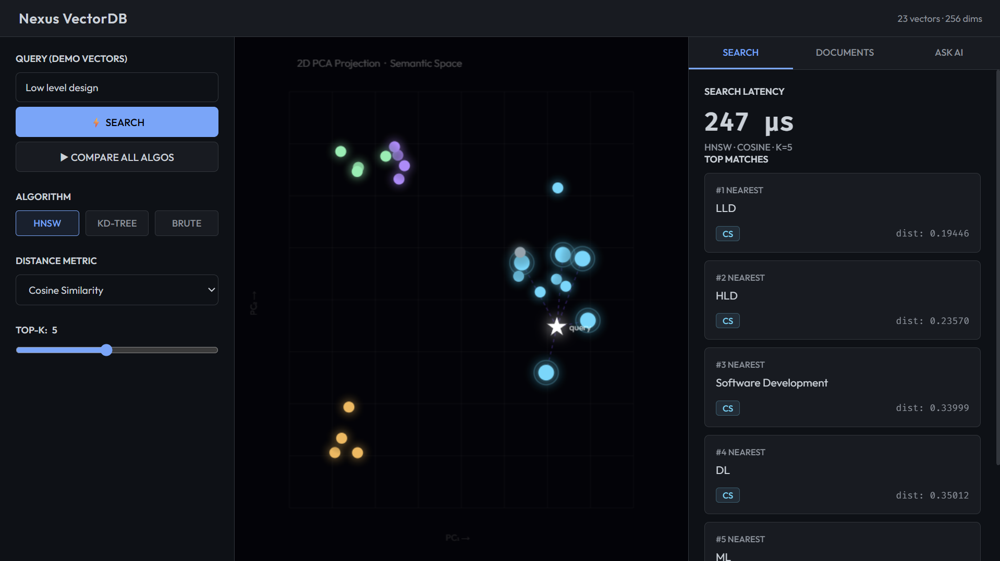
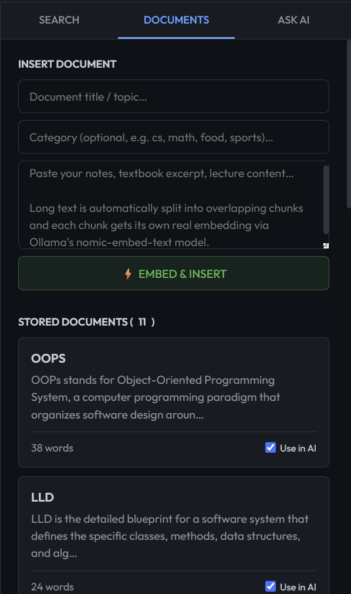
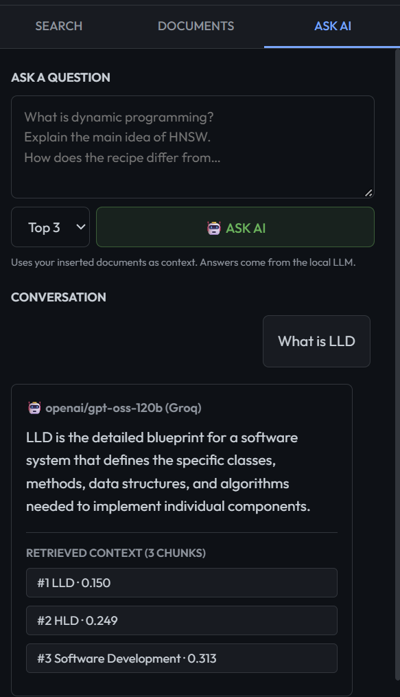

# Nexus VectorDB — Build a Vector Database from Scratch in Java

A fully working **Vector Database** built from scratch in Java with a web UI.  
Implements **HNSW**, **KD-Tree**, and **Brute Force** search algorithms side-by-side, plus a **RAG pipeline** powered by Cloud APIs (Gemini & Groq).

> Built as an educational project to show how production vector databases like Pinecone, Weaviate, and Chroma actually work under the hood.

---

## Screenshots



<p align="center">
  
  &nbsp;&nbsp;
  
</p>

---

## What This Project Does

| Feature | Description |
|---|---|
| **3 Search Algorithms** | HNSW (production-grade), KD-Tree, Brute Force — run all three and compare speed |
| **3 Distance Metrics** | Cosine similarity, Euclidean distance, Manhattan distance |
| **2D PCA Scatter Plot** | Live visualization of semantic space — watch clusters form in real time |
| **Real Document Embedding** | Paste any text → Embedded using Gemini API (`gemini-embedding-2`, 256D) |
| **RAG Pipeline** | Ask questions about your documents → HNSW retrieves context → Groq LLM answers |
| **Full REST API** | CRUD endpoints: insert, delete, search, benchmark, hnsw-info |

---

## Why Two API Keys? (Gemini + Groq)

This project uses a **hybrid Cloud API** approach to get the best of both worlds while staying within free tiers:

| API | Role | Why |
|---|---|---|
| **Google Gemini** (`gemini-embedding-2`) | Embeddings | Groq does not offer an embedding model, so Gemini handles all vector generation |
| **Groq** (`openai/gpt-oss-120b`) | Generation (LLM) | Gemini's free tier is limited for text generation; Groq offers fast inference with a generous free quota |

Simply put: **Gemini embeds, Groq generates.** Both are free to use within their respective free tiers.

---

## How It Works

```
Your Text
    │
    ▼
Gemini API (Embeddings)            ← converts text to a 256-dimensional vector
    │
    ▼
HNSW Index (Java)                  ← indexes the vector in a multilayer graph
    │
    ▼
Semantic Search                    ← finds nearest neighbors in vector space
    │
    ▼
Groq API (Generation)              ← reads retrieved chunks, generates an answer
    │
    ▼
Answer
```

**HNSW (Hierarchical Navigable Small World)** is the same algorithm used by Pinecone, Weaviate, Chroma, and Milvus. It builds a multilayer graph where each layer is progressively sparser — searches start at the top layer and zoom in, achieving O(log N) complexity instead of O(N) for brute force.

---

## Prerequisites

- **Java JDK 17+** installed
- A free **Gemini API key** from [aistudio.google.com](https://aistudio.google.com)
- A free **Groq API key** from [console.groq.com](https://console.groq.com)

---

## Setup

### Step 1 — Clone the Repository

```bash
git clone https://github.com/Pradyumn-Chaudhary/NexusVectorDB.git
cd NexusVectorDB
```

### Step 2 — Set API Keys

**Option A — `.env` file (recommended):**

Create a `.env` file in the project root:
```
GEMINI_API_KEY=your_gemini_key_here
GROQ_API_KEY=your_groq_key_here
```

**Option B — System environment variables:**

Windows (PowerShell):
```powershell
$env:GEMINI_API_KEY="your_gemini_key_here"
$env:GROQ_API_KEY="your_groq_key_here"
```

Linux / Mac:
```bash
export GEMINI_API_KEY="your_gemini_key_here"
export GROQ_API_KEY="your_groq_key_here"
```

> The server checks `.env` first. If not found, it falls back to system environment variables.

### Step 3 — Compile and Run

```bash
javac Main.java
java Main
```

You should see:
```
=== VectorDB Engine ===
http://localhost:8080
0 vectors | 256 dims | HNSW+KD-Tree+BruteForce
Cloud APIs: ONLINE
  embed: gemini-embedding-2 (Gemini)
  gen: openai/gpt-oss-120b (Groq)
```

Open your browser at **http://localhost:8080**.

---

## Using the Application

### Tab 1: Search

Insert some vectors first using the REST API or via the Documents tab. Then type any concept, pick an algorithm and distance metric, and hit **⚡ SEARCH**.

- Results appear with distances on the right panel
- The matching point glows on the 2D scatter plot, connected by dashed lines to the query star
- Click **▶ COMPARE ALL ALGOS** to benchmark all 3 algorithms simultaneously

The scatter plot projects all vectors to 2D using PCA. As you insert documents from different domains, notice how semantic categories naturally cluster together — this is what "semantic similarity" looks like visually.

### Tab 2: Documents

Embed any real-world text into the database using the Gemini API.

1. Enter a title (e.g., `Operating Systems Notes`)
2. Optionally set a category (e.g., `cs`, `math`, `food`, `sports`)
3. Paste any text — lecture notes, articles, documentation
4. Click **⚡ EMBED & INSERT**

Long documents are automatically chunked into overlapping 250-word segments, each with its own embedding. Stored documents are listed below with a preview and word count.

### Tab 3: Ask AI (RAG Pipeline)

Ask questions over your inserted documents. The engine retrieves the most semantically relevant chunks and feeds them to the LLM as context.

1. Insert documents in Tab 2 first
2. Type your question and click **🤖 ASK AI**

Behind the scenes:
```
1. Question → Gemini embeds it (256D)
2. HNSW retrieves top-K nearest chunks
3. Chunks are sent as context to Groq API
4. LLM generates a grounded answer
```

The answer types in with a typewriter effect. The **RETRIEVED CONTEXT** section shows exactly which chunks (with distance scores) the AI used to form its answer. The query star also appears on the scatter plot, showing where your question lands in semantic space.

---

## REST API Reference

Base URL: `http://localhost:8080`

### Vector Endpoints

| Method | Endpoint | Description |
|---|---|---|
| `POST` | `/search` | K-NN vector search |
| `POST` | `/insert` | Insert a vector |
| `DELETE` | `/delete/:id` | Delete by ID |
| `GET` | `/items` | List all vectors |
| `POST` | `/benchmark` | Compare all 3 algorithms |
| `GET` | `/hnsw-info` | HNSW graph structure stats |
| `GET` | `/embed?text=...` | Embed text via Gemini API |

### Document & RAG Endpoints

| Method | Endpoint | Body | Description |
|---|---|---|---|
| `POST` | `/doc/insert` | `{"title":"...","text":"..."}` | Embed and store a document |
| `GET` | `/doc/list` | — | List all stored documents |
| `DELETE` | `/doc/delete/:id` | — | Delete a document chunk |
| `POST` | `/doc/ask` | `{"question":"...","k":3}` | RAG: retrieve context + generate answer |

### Example: Search via curl

```powershell
curl -X POST http://localhost:8080/search `
  -H "Content-Type: application/json" `
  -d '{"embedding":[0.1,0.2,...],"k":5,"metric":"cosine","algo":"hnsw"}'
```

### Example: Ask a question via curl

```powershell
curl -X POST http://localhost:8080/doc/ask `
  -H "Content-Type: application/json" `
  -d '{"question":"What is dynamic programming?","k":3}'
```

---

## Project Structure

```
VectorDB/
├── Main.java        ← Java backend (HNSW, KD-Tree, BruteForce, REST API, RAG)
├── index.html       ← Frontend (PCA scatter plot, chat UI, benchmark)
├── vector_db.jsonl  ← Persistent storage (Append-only Write-Ahead Log)
└── assets/          ← Screenshots
```

### Architecture (Main.java)

```
BruteForce     O(N·d)      Exact, baseline
KDTree         O(log N)    Exact, axis-aligned partitioning
HNSW           O(log N)    Approximate, multilayer small-world graph

VectorDB       Unified interface over all 3
DocumentDB     HNSW-only index for real Gemini embeddings (256D)
CloudClient    HTTP client → Gemini (Embeddings) + Groq (Generation)
```

---

## Algorithm Deep Dive

### HNSW (Hierarchical Navigable Small World)

Nodes are inserted into a multilayer graph. Each node randomly gets assigned a maximum layer. Layer 0 has all nodes with many connections; higher layers have fewer nodes (exponentially fewer) with longer-range connections.

**Insert:** Start at the top layer, greedily find the nearest node, drop a layer, repeat. At each layer from your assigned max down to 0, run a beam search (ef_construction=200) and connect to the M nearest neighbors bidirectionally.

**Search:** Same greedy descent from top layer. At layer 0, expand to ef nearest candidates using a priority queue.

**Why it's fast:** The upper layers act like a highway — you quickly get to the right neighborhood, then zoom in at layer 0.

### KD-Tree (K-Dimensional Tree)

Binary space partitioning. Each node splits space along one dimension (cycling through all dimensions). Search prunes entire subtrees when the closest possible point in that subtree can't beat the current best.

**Weakness:** Degrades with high dimensions (curse of dimensionality). Works well for ≤20D, degrades toward brute force at 768D.

### Why HNSW Wins at High Dimensions

KD-Tree pruning relies on axis-aligned distance bounds. In high dimensions, almost all the space is near the boundary of the hypersphere — no subtrees get pruned. HNSW's graph-based approach doesn't have this problem.

---

## License

MIT — use this however you want.
